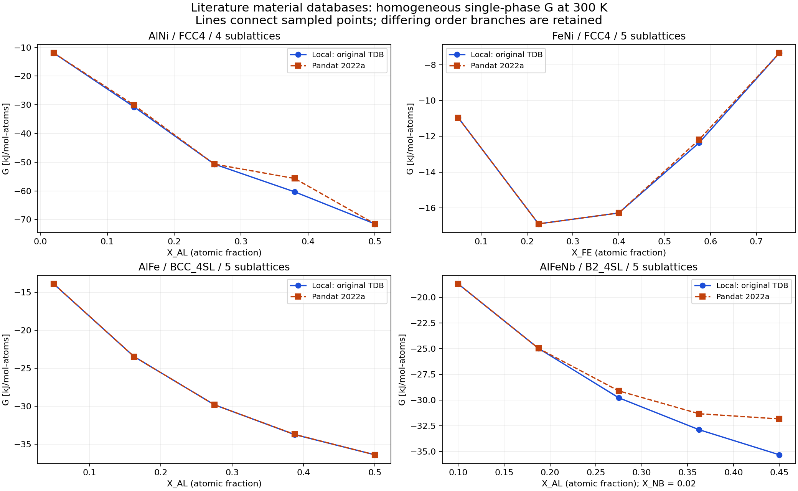
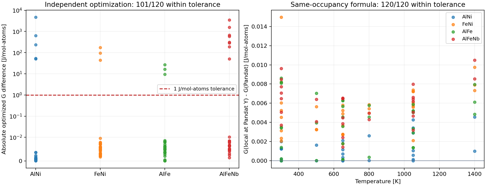

# 真实四、五亚点阵材料库：文献来源与 Pandat 对比

2026-10-18，使用 Pandat 2022a Education（文件版本 2022.0.0.0）完成 **4 个材料体系、14 组曲线、120 个独立单点**。**同一组 Pandat 占位下的自由能公式 120/120 点通过**，最大差 **0.0149613 J/mol-atoms**。两边各自优化占位后，**101/120 点通过，19 点保留为失败**，最大差 **4661.583067 J/mol-atoms**。不能把这次结果表述为真实材料库全部验证通过。

## 数据库来源及模型

通过 [TDBDB](https://avdwgroup.engin.brown.edu/) 的元素检索追踪数据库，再核对出版社附件、论文作者发布的数据集及作者仓库。TDBDB 是索引，下载版本仍需单独核实。

| 体系及文件 | 来源和版本 | 实际相模型 | 磁性覆盖 |
|---|---|---|---|
| Al–Ni，`alni-4slx.TDB` | [Sundman 的 OpenCalphad 仓库](https://github.com/sundmanbo/opencalphad/blob/2182307cd22019542206bc12b7779ff48e2b6609/examples/macros/alni-4slx.TDB)，2017-08-02 | `FCC4`：4 × `(AL,NI)0.25`，**四亚点阵** | 化学有序 + 磁性无序参考；有序相自身没有 TC/BMAGN 参数 |
| Fe–Ni，`feni_cac.tdb` | [Yang/Oyedeji 的公开研究数据集](https://zenodo.org/records/7767663)，基于 [Cacciamani 等，2010](https://doi.org/10.1016/j.intermet.2010.02.026) | `FCC4`：4 × `(FE,NI)0.25` + `(VA)1`，**五亚点阵** | 有序侧 TC/BMAGN 修正 + 磁性无序参考 |
| Al–Fe，`AlFe-4SLBF.TDB` | [Sundman 作者仓库](https://github.com/sundmanbo/REDUNDANTXML/blob/d40337bea26d9c72d8c2f8343cfdbc80c98841c5/software/examples/AlFe-4SLBF.TDB)，2008-08-15 | `BCC_4SL`：4 × `(AL,FE)0.25` + `(VA)3`，**五亚点阵** | 有序侧 TC/BMAGN 修正，BCC 对称参数、通配相互作用 |
| Al–Fe–Nb，`ALFENB-B2-4SL.TDB` | [Guo 等，2017](https://doi.org/10.1016/j.calphad.2017.03.005) 的 [出版社附件](https://ars.els-cdn.com/content/image/1-s2.0-S0364591616302358-mmc2.zip) | `B2_4SL`：4 × `(AL,FE,NB)0.25` + `(VA)3`，**五亚点阵** | 三元有序侧 TC/BMAGN 修正，非零 Nb 成分 |

文件名中的 `4SL` 往往只计算四个置换亚点阵，TDB 中还包括固定 VA 亚点阵。这里按 `PHASE` 的实际定义计数。

版本边界：

- Fe–Ni 是 NIMS 在 2012 年整理、后由 2023 年论文配套数据集分发的文件。文件头说明了原文部分符号修订及空位端元约定；本次保留这些已发布的内容，没有自行改回原文符号。SHA256 和 Zenodo 公布的 MD5 均已核对。
- Al–Fe 作者仓库版本与 [Sundman 等 2009 年评估](https://doi.org/10.1016/j.actamat.2009.02.046) 相关，但本次没有证明它与期刊最终附件逐字节相同。
- Al–Ni 是作者仓库的材料示例/工作文件，含 Dupin/Sundman 引文、未列明的 REF0 和 `at work` 参考。不能称为已经确认版本的最终期刊附录。
- **原生四亚点阵、且有序侧含独立 TC/BMAGN 修正的文献库，仍未获得验证结果。** 当前四亚点阵材料测试验证的是有序化与磁性参考共存；完整的占位依赖磁性耦合由三个五亚点阵体系覆盖。

精确 URL、版本分类和字节哈希见 [来源清单](validation/literature-sources.json)。原 TDB 保存在忽略的 `data/`；仓库文档只保存来源及数值结果，不重新分发下载库。

## 条件与结果

比较对象为**单一均匀相**，两边均优化内部占位，不允许两相分解或同一相分裂。P=101325 Pa；能量单位 J/mol-atoms，固定 VA 不计入原子数。能量绝对容差 1、`rtol=0`；成分/占位文本容差 3e-6；有序振幅 q 容差 1e-3。q 是四个等价置换位点上首个元素占位的加权标准差，对位点交换不敏感，但不区分所有有序结构。

G–T 温度为 **300、500、650、800、1050、1400 K**；G–成分曲线在 **300、650、1050 K**，每条等间距取 5 个成分点。均在引用函数有效温区内。

| 体系 | G–T 总体原子分数 | G–成分路径 | 点数 |
|---|---|---|---:|
| Al–Ni | xAL=0.25、0.10 | xAL=0.02→0.50，Ni 为余量 | 27 |
| Fe–Ni | xFE=0.50、0.25、0.215 | xFE=0.05→0.75，Ni 为余量 | 33 |
| Al–Fe | xAL=0.15、0.25、0.50 | xAL=0.05→0.50，Fe 为余量 | 33 |
| Al–Fe–Nb | (AL,FE,NB)=(0.24,0.75,0.01)、(0.25,0.70,0.05) | xAL=0.10→0.45，xNB=0.02，Fe 为余量 | 27 |

本程序采用 32 起点 SLSQP，Pandat 通过 `IndividualPhase` 独立求解。未以本程序输出填充 Pandat 的参考值。每点均检查成功日志和原始 DAT，进程退出码本身不作为计算成功证据。

| 体系 | 优化 G 通过 | 同占位公式通过 | 最大优化 G 差 | 最大同占位公式差 |
|---|---:|---:|---:|---:|
| Al–Ni 四亚点阵 | 22/27 | 27/27 | 4661.583067 | 0.004555 |
| Fe–Ni 五亚点阵 | 30/33 | 33/33 | 174.008536 | 0.014961 |
| Al–Fe 五亚点阵 | 30/33 | 33/33 | 27.270428 | 0.008606 |
| Al–Fe–Nb 五亚点阵 | 19/27 | 27/27 | 3488.705946 | 0.010492 |

整体按曲线分组为 **5/14 组通过**。其余 9 组保留 `failed`，即使同占位公式吻合也不改成通过。





连线只连接采样点，不表示连续区间已逐点验证。完整数据见 [120 点明细](validation/pandat-literature-points.csv)、[19 个差异点](validation/pandat-literature-failures.csv)、[按材料汇总](validation/pandat-literature-summary.csv)。

## 差异诊断

19 个超差点均为本程序获得较低 G。把 Pandat 输出的全部亚点阵占位代入原始数据库构建的本程序模型，公式仍然吻合。因此，当前证据支持占位搜索返回不同分支，而不是几千 J/mol 的公式偏差。结论限于这个 Pandat 版本、数据库表示和批处理设置。

另以独立差分进化搜索复核全部 19 点：三个置换位点为自由变量，第四个位点由总成分守恒决定；二元问题为 3 个变量，三元为 6 个变量；固定 VA 保持 1。种群独立随机采样，不用本程序或 Pandat 解作为初值。`seed=20261018`、`popsize=24`、`maxiter=1200`、`tol=1e-10`，随后可作 SLSQP 精化。

- **18 点**重现本程序较低分支，最大能量差约 **5.69e-6 J/mol-atoms**。包括每个体系最大偏差点；约束残差也保存在诊断文件中。
- **剩余 1 点**为 Al–Ni，300 K、xAL=0.10。差分进化虽然报告收敛，得到的 G 仍比本程序高约 **50.145835 J/mol-atoms**，接近 Pandat 返回的分支。这说明单次差分进化的“收敛”也不是全局最小保证。该点没有被纳入独立一致的 18 点。
- 全部结果仍标记为有差异；没有据此声称本程序已证明全局最优，也没有将结论扩大到 Pandat 的其他版本、起点设置或全部模型。

例如 Al–Ni 在 300 K、xAL=0.38 时，本程序 G=-60351.513767，Pandat G=-55689.930700，独立差分进化/精化 G=-60351.513767 J/mol-atoms。Pandat 返回无序 A1，本程序及独立搜索找到有序占位的更低分支。详见 [独立搜索 JSON](validation/pandat-literature-diagnosis.json)。

后续计算应保留多起点能量分布、占位和有序振幅，并在有序转变附近复核多个分支；不能只按某一软件的“收敛”标志认定平衡。当前 `global_minimum_certified=false` 的输出约定继续保留。

## 补充诊断：对称占位与初值（2026-10-18）

在五个代表点完成 **45 组** Pandat 对照；每点另运行一次默认模式导出初始化学势。每个对照使用独立进程，保持数据库、T/P、总体成分不变，仅改变计算模式和初始占位。PBFX 同时记录所有位点、固定 VA 和化学势初值。以本程序解作初值属于定向诊断，不是独立验证。

| 代表点 | Pandat − 本程序低能解 / J mol-atoms⁻¹ | 本程序中施加的等占位条件 | 解除条件后的局部稳定性 |
|---|---:|---|---|
| Al–Ni，300 K，xAL=0.10 | 50.158841 | 四个位点占位相同 | 正曲率，仍回到高能局部极小值 |
| Al–Ni，300 K，xAL=0.38 | 4661.583067 | 四个位点占位相同 | 正曲率，仍回到高能局部极小值 |
| Fe–Ni，500 K，xFE=0.50 | 94.806122 | y₁=y₄、y₂=y₃ | 存在负曲率，微扰后降至原低能解 |
| Al–Fe，650 K，xAL=0.25 | 9.549716 | y₁=y₂、y₃=y₄ | 存在负曲率，微扰后降至原低能解 |
| Al–Fe–Nb，300 K，(AL,FE,NB)=(0.45,0.53,0.02) | 3488.705946 | 四个置换位点占位相同 | 存在负曲率，微扰后降至原低能解 |

位点编号从 1 开始，相等关系作用于该位点所有置换组元；第五个固定 VA 保持 1。在本程序中按导出占位施加这些相等条件后，G 与 Pandat 的差小于 0.014 J/mol-atoms。三种差分步长 1e-4、5e-5、1e-5 的曲率符号一致。Fe–Ni 与 Al–Fe 在受限空间曲率为正、完整空间存在负特征值；对该方向施加约 1e-3 的守恒扰动后，无约束于等占位关系的局部优化即可重现低能分支。Al–Fe–Nb 也有降能方向，两个符号的微扰均得到成功且可行的低能结果。所有组成守恒、位点归一化残差及优化状态均保存在 JSON 中。

**这里验证的是：观察到的等占位模式足以解释这些能量差；还没有证实 Pandat 内部强制施加了相等约束。** 在完全对称的初值上，局部求解也可能保持原对称性而停在完整空间的鞍点。数据库的对称参数展开只定义能量的等价关系，不要求有序解的所有等价位点具有相同占位，不能为“对齐软件”而直接把完整模型缩减为两两相等。

**亚点阵间化学势平衡复核。** 对本轮固定原子数的置换模型，定义交换势
`M_A-B(s) = N_atoms/a_s * (∂G_m/∂y_A(s) - ∂G_m/∂y_B(s))`。
允许交换且占位在内部时，各点阵的交换势应相等；这里的归一化系数不可省略。它来自位点归一化和总体成分守恒约束下最小化自由能的一阶条件，不是额外的等占位约束。`GibbsModel.feasible_space/minimize` 已包含这些守恒与占位边界，但当前成功验收尚未独立核查化学势/KKT 残差。

将 Pandat 原始占位代入本程序，Fe–Ni、Al–Fe 的交换势跨点阵最大差分别为 0.004315、0.029355 J/mol；沿同一对称分支在本程序内精化后，分别约为 6.59e-8、1.32e-6 J/mol。尽管一阶条件已高度满足，两者仍有负曲率。Al–Fe–Nb 的均匀占位交换势也相等而存在负曲率。因此“化学势平衡”和“稳定极小值”必须分开检查，当前差异不能简单归结为漏掉了化学势平衡约束。精化值不是 Pandat 原始结果。

本程序原低能解也不能只看 success：Al–Ni、300 K、xAL=0.10 的跨点阵交换势差约 0.22055 J/mol。它提示需要独立的导数残差验收，不能用能量误差替代。Al–Ni xAL=0.38 与 Al–Fe–Nb 的低能占位落在边界，本次等式复核将其标记为 `boundary_state_requires_one_sided_KKT`，不把它们计为一阶条件通过。完整数值已并入诊断 JSON 的 `chemical_potential_check`。

实际 Pandat 模式对照结果：

- 旧 `individual_phase=true`、显式 `equilibrium_type=individual`、`individual` 加本程序低能占位初值：15/15 组有均匀单相输出，同一点 G 与原基线相同。**没有证据说明该入口采用了所给初值**，也不能仅凭输出不变证明其忽略初值。
- `local` 分别输入原 Pandat 占位、微小非对称混合、低能占位、交换前两位点后的占位：20/20 组出现 `System.AccessViolationException`。四种初值均保持总成分和位点归一化。交换位点仅作另一起点，BCC 的此交换不预设为能量等价操作。
- `global` 默认及带低能初值：10/10 组输出相分解，包括同一模型的两个不同成分相。这些是不同的热力学比较对象，不能计为均匀单相曲线通过。
- 安装自带 `AlMgZn.tdb` 的简单 Al–Zn 控制：同条件 `global` 成功；按手册 Fcc/Hcp 初值设置的 `local`、省略固定 VA 初值的 `local`、仅 Fcc 的 `local` 均出现相同访问异常。该异常不只在复杂有序库发生；尚不能区分版本缺陷、当前批处理入口兼容性或其他环境因素，也不能声称是学习版限制。

输入格式核对了本机 **Pandat 2022 手册印刷页 89–90（PDF 第 97–98 页）**和[官方局部平衡说明](https://computherm.com/Pandat_Online_Help/LocalEquilibrium.html)。`struct(@*)` 的等占位结构说明见 PDF 第 276 页。注意手册的组分 Hessian 与本次固定成分、内部占位 Hessian 是不同对象。

新增 `pandat_occupancy_diagnosis.py`、`pandat_symmetry_diagnosis.py`、`pandat_occupancy_report.py`；抽取批处理运行函数，保持原始验证的构造参数不变。新增 5 项回归，加原批处理测试共 **9 项通过**。没有调整数据库物理参数或生产计算器公式。

运行证据在 `data/pandat_occupancy_diagnosis_56560b3f2dc0`；摘要及完整数值快照见 [CSV](validation/pandat-occupancy-summary.csv) 和 [JSON](validation/pandat-occupancy-diagnosis.json)。原 HTML 报告新增了本节对应的诊断内容，原有 120 点统计与失败记录不变。

```powershell
python -m examples.pandat_occupancy_diagnosis data/pandat_literature_validation_0a76eb40994c/summary.json
# 将新运行目录填入下一条命令。
python -m examples.pandat_symmetry_diagnosis data/pandat_literature_validation_0a76eb40994c/summary.json --output data/pandat_occupancy_diagnosis_<编号>/symmetry.json
python -m pytest -q tests/test_pandat_batch.py tests/test_pandat_occupancy_diagnosis.py
```

## 其他计算引擎实测（2026-10-18）

已安装 Thermo-Calc Education 2026b（2026.2.201356-1197）、OpenCalphad 6.056（Windows 官方稳定安装包，内核日期 2022-07-16）、独立环境的 pycalphad 0.11.2、MatCalc 6.10.1.002 免费模式。生产环境仍锁定 pycalphad 0.11.1。Thermo-Calc 官方签名安装包通过校验，安装于 `%LOCALAPPDATA%/Programs/Thermo-Calc-educational/2026b`；自带许可证、控制台宏和自定义 TDB 导入已实测。FactSage Education 官方禁用 TDB 导入、宏与 ChemApp for Python，因此未安装用于本次比较。

对 AlNi_gx 第 3 点、AlNi_gt_2 第 0 点、FeNi_gt_1 第 1 点、AlFe_gt_2 第 2 点、AlFeNb_gx 第 4 点（索引从 0 起）进行独立求解。每点 37 个起点，由守恒占位多面体的线性规划顶点及凸组合产生；未用原有低能解或 Pandat 解作为起点。保留全部起点和失败记录。

- **OpenCalphad**：读取未修改的原始 TDB；每次新进程、仅目标相 entered、`calculate no-global`。185 次输出均满足单目标相、相量 1、组成及打印精度下的占位归一化检查。每点最低 G 均复现本程序低能分支，最大差 **0.004428304 J/mol-atoms**。不同起点仍能到达高能分支，不能把 185 次收敛解释为 185 次全局最小值。输出能量约 8 位有效数字，位点分数约 6 位有效数字；所有参考标记缺失、无关相跳过等读取提示保留在日志内。
- **Thermo-Calc Education 2026b**：相同原始 TDB、相同 37 个初值，每次重置 POLY、仅进入目标相并显式设置全部可变占位，使用 `COMPUTE_EQUILIBRIUM -`。185/185 次通过收敛、输入占位回显、单相量、组成和全部位点归一化检查。五点最低 G 与 OpenCalphad 在打印精度下一致，与本程序最大差 **0.004428304 J/mol-atoms**。教育版三组分限制不阻止本轮四/五亚点阵和固定 VA 模型。官方启动器额外传入 `demo` 参数；脚本按实际官方 Java 启动命令运行，不修改许可证。
- **pycalphad 原生模型 + 原生求解器**：每次一个 CompositionSet，避免同相分裂。Al–Ni 两点与原解一致。Fe–Ni、Al–Fe、Al–Fe–Nb 的默认模型均警告有序/无序物性分配可能不正确；同一占位的能量已经不同，不能当成同公式求解器对照。
- **现有磁性模型 + pycalphad 原生求解器**：5 点都复现原低能解，最大差小于 4e-6 J/mol-atoms。这只能隔离求解器差异，因为项目本身使用 pycalphad 的模型基础。两种模式共 370 次求解，367 次满足收敛、相量、组成、归一化与边界条件；3 次未接受的 Al–Fe–Nb 起点保留。
- **MatCalc**：公开 C API 在无许可证的免费模式下跑通官方 Al–Mg–Si 三元例子，873.15 K、101325 Pa、98/1/1 wt%，GM = −34754.071647 J/mol，FCC_A1 + LIQUID。原始文献库明确选择 VA 后，4 个点仍报告忽略 TYPE_DEFINITION 的无序参考连接，要求 MatCalc 专属 ATTACH_CONTRIBUTION；Al–Fe 在 ASSESSED_SYSTEM 元数据处报未知关键字。Al–Ni 一次达到迭代上限，即使 API 返回 0 也不算通过。这 5 个 MatCalc 文献结果全部排除于有效能量比较；未以省略有序/磁性贡献的方式强行对齐。

Thermo-Calc 五点最低 G（J/mol 原子）：AlNi_gx −60351.514、AlNi_gt_2 −24151.751、FeNi_gt_1 −21808.055、AlFe_gt_2 −41920.897、AlFeNb_gx −35315.442。Fe–Ni 对称初值可停在 −21713.244，非对称初值到达 −21808.055；Al–Fe–Nb 可出现 −31826.735、−32881.678 和 −35315.442 三个分支。单次收敛和化学势平衡不足以证明全空间稳定性。

Thermo-Calc 导入边界：Al–Fe 的 `ASSESSED_SYSTEM` 元数据引用了不存在的 `A2_B2` 相，因此自动回退至 **GES5**；其余四点使用 GES6。没有改动原库参数，不能声称 Al–Fe 已通过 GES6。Al–Fe–Nb 的 `NO REFERENCE FILE` 和 Al–Ni 的 `REF0` 缺失属于参考文献索引提示；原始日志保留，解析器只放行已核对的这两类提示及明确的 Al–Fe 元数据回退，其他导入错误拒绝比较。

两次整组运行在宏已报告正常完成后等待消息服务退出；脚本等待 15 秒后结束该测试应用，记录真实退出码 1 和 `stopped_after_normal_macro_completion=true`。是否可比依靠各次计算和文件检查，不能仅凭退出码。探索阶段 `thermocalc-pilot3` 含多余固定 VA 输入，已保留为调试记录，不计入正式证据。

以上是原 19 个差异点中的 5 个，原 120 点 / 19 个差异的统计没有改变。Thermo-Calc 和 OpenCalphad 的独立结果增强了低能分支存在的证据，但并未证明所有 Pandat 差异都是软件缺陷，也未补齐边界 KKT、全局稳定性及真实可变空位/间隙专项验证。

数值快照：[CSV](validation/cross-engine-summary.csv)、[JSON](validation/cross-engine-summary.json)、[Thermo-Calc 全初值审计](validation/thermocalc-validation.json)；[安装清单](validation/cross-engine-installations.json)包含官方来源、版本、路径和哈希。完整数据和日志在 `data/cross_engine_validation_20261018`，现有 HTML 报告新增 `#cross-engine` 节。结果判定测试 **23 项通过**，覆盖相分裂、组成/归一化不符、缺失能量、初值错位、模型定义被忽略及零返回码的计算失败。

在仓库目录复现（已安装环境；不要给独立环境设置指向旧依赖的 PYTHONPATH）：

```powershell
$crossPython = '..\review\thermo-engines\pycalphad-venv\Scripts\python.exe'
$crossData = 'data/cross_engine_validation_20261018'
$env:MPLCONFIGDIR = (Resolve-Path -LiteralPath '..\review\mpl-cache').Path
& $crossPython examples/cross_engine_pycalphad.py data/pandat_literature_validation_0a76eb40994c $crossData
& $crossPython examples/cross_engine_opencalphad.py $crossData --exe 'D:\ThermoTools\OpenCalphad\oc6P.exe'
& $crossPython examples/cross_engine_matcalc.py $crossData --home 'D:\ThermoTools\MatCalc6'
& $crossPython examples/cross_engine_thermocalc.py $crossData --home "$env:LOCALAPPDATA\Programs\Thermo-Calc-educational\2026b"
# 无需启动 Thermo-Calc，重新审计已保存日志：
& $crossPython examples/cross_engine_thermocalc.py $crossData --reparse
& $crossPython examples/cross_engine_report.py $crossData data/pandat_literature_report_6b56df150714/report.html
```

新机器可在独立 venv 内安装 `requirements-cross-engine.txt`；OpenCalphad/MatCalc 需分别使用其官方安装包。本轮脚本针对这些四个等容量置换亚点阵、可附带固定 VA 的具体算例，尚不是任意数据库的通用后端。MatCalc 的方言适配需另行核对能量、磁性及对称展开，不能仅换一条关键字就宣布等价。

## 导入适配与代码变化

新增 `examples/pandat_tdb.py` 和文献验证/诊断/报告脚本。没有改变物理参数或主计算器的自由能公式。

1. 下载文件按固定 URL/提交及 SHA256 校验，ZIP 同时校验压缩包与成员文件；已有文件哈希不符会报错，不静默替换。
2. 本程序读取原始库。Pandat 导入副本只保留目标相及无序参考，将 `:B/:F` 的对称参数显式写出，保留通配参数；统一 `DISORDER_PART`、函数引用 `#`、`LN` 和相专属字母类型标记。通配参数无需展开。
3. 转换前后选中参数数目相同：Al–Ni 35、Fe–Ni 59、Al–Fe 74、Al–Fe–Nb 141。转换副本和原文件分别留哈希，不能覆盖原文件。修正了 pycalphad 0.11.1 `Database.__deepcopy__` 仍共享相对象带来的修改风险。
4. 在随机归一化占位与全部端元上检查 G/TC/BMAG：二元各 32 态 × 6 温度，三元 97 态 × 6 温度，合计 **1158 个状态**。最大 G 差为 0，最大 TC 差 8.53e-14 K，最大 BMAG 差 5.55e-17。独立复查的导入副本与实际送入 Pandat 的文件逐字节相同。此抽样检查不替代外部交叉验证。
5. 比较器分别记录 `original.tdb` 和 Pandat 的 `model.tdb`，避免把转换后的作者库误记为“未修改的安装示例”。原始探路运行不计入本报告的 120 点；正式来源分类为 `prepared_public_material_database`。

[转换审计](validation/pandat-literature-conversion.json) 保存全部操作和哈希。回归 **135 项通过**，含新增的对称参数保留、磁性参数变动拒绝、源文件保护和哈希不符拒绝；新增脚本静态错误检查通过。

## 复现及范围

安装 `requirements-thermo.txt`，准备自己的 Pandat 安装和许可。首次可用 `--fetch` 下载固定版本；源文件须在项目数据目录内。已有下载可用 `--source-dir data/literature_sources_20261018`，无须再访问网络。

```powershell
python -m examples.pandat_literature_validation --executable 'D:\Program Files\CompuTherm LLC\Pandat 2022a Education\bin\Pandat.exe' --version '2022a Education (2022.0.0.0)' --fetch
# 可用 --cases FeNi_gt_2 FeNi_gt_3 只复现指定曲线。
# 完整矩阵因保留差异而返回非零状态；不是运行中断。
python -m examples.pandat_literature_diagnosis data/pandat_literature_validation_<编号>/summary.json --all-failures
python -m examples.pandat_literature_report data/pandat_literature_validation_<编号>/summary.json
python -m pytest -q
```

正式运行目录 `data/pandat_literature_validation_0a76eb40994c`；HTML、PNG/SVG、CSV 报告在 `data/pandat_literature_report_6b56df150714`。保留成功日志、PBFX、原始 DAT、原库/导入库副本、请求和全部失败记录。此前人工/安装示例矩阵见 [多模型验证](gibbs-validation.md)、[材料专项](gibbs-material-validation.md)，本轮是独立新增矩阵。

尚未覆盖：Fe–Ni BCC4 等所有置换位点均允许 VA 的模型、原生四亚点阵有序侧磁性修正的文献库、可变间隙与本轮四置换位点同时耦合、Xiong 磁性、多相平衡以及实验预测精度。本次固定 VA 不能替代真实可变空位/间隙验证。
