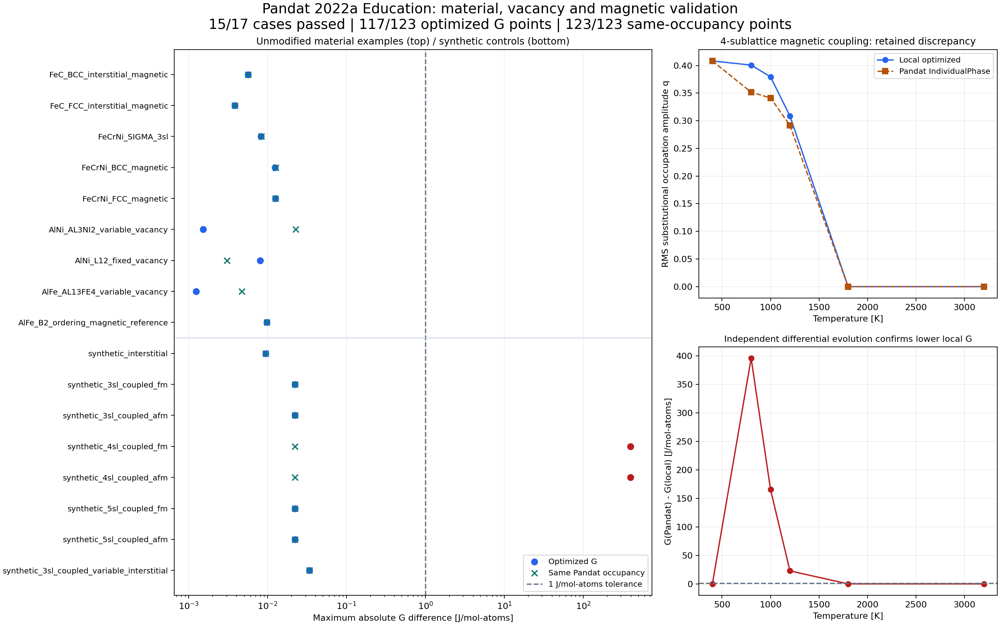

# 材料数据库、空位/间隙及磁性有序专项验证

2026-10-18 使用本地 Pandat 2022a Education（文件版本 2022.0.0.0）完成 **17 组、123 个单点**。9 组真实材料体系示例、75 点全部通过；8 组人工控制模型、48 点中有 6 点的优化结果超差，保留失败结论。**同一组 Pandat 占位下的自由能表达式对比 123/123 点通过**，最大差 0.033653 J/mol-atoms。

本记录中的材料数据库为用户 Pandat 安装附带的 Fe–C、Fe–Cr–Ni、Al–Ni、Al–Fe 示例 TDB，使用原文件副本，不修改参数。它们验证程序对实际数据库的解析与计算一致性；未检验数据库相对于实验的预测精度，也不代表用户目标难熔合金数据库已得到验证。尚未执行 Thermo-Calc。

## 条件和结果

各点 P=101325 Pa，比较单一均匀相的 G，默认优化内部占位；不进行多相或同相分裂平衡。能量绝对容差 1 J/mol-atoms，`rtol=0`；成分/占位文本容差 3e-6；有序占位振幅 q 容差 1e-3。32 个起点的本程序优化与 Pandat `IndividualPhase` 独立运行，外部数据不来自本程序预测。

| 材料体系及相 | 点数 | 主要覆盖 | 最大 G 差，J/mol-atoms | 结果 |
|---|---:|---|---:|---|
| Fe–C BCC | 12 | C/VA 间隙、磁性、1043 K 边界 | 0.005641 | 通过 |
| Fe–C FCC | 9 | C/VA 间隙、磁性 | 0.003835 | 通过 |
| Fe–Cr–Ni SIGMA | 6 | 三亚点阵、不等位点权重 | 0.008233 | 通过 |
| Fe–Cr–Ni BCC | 9 | 三元磁性 | 0.012412 | 通过 |
| Fe–Cr–Ni FCC | 9 | 三元磁性 | 0.012467 | 通过 |
| Al–Ni AL3NI2 | 6 | 可变空位、原子数归一化 | 0.001518 | 通过 |
| Al–Ni L12_FCC | 9 | 固定 VA 亚点阵 | 0.007993 | 通过 |
| Al–Fe AL13FE4 | 6 | 可变空位、受限成分 | 0.001232 | 通过 |
| Al–Fe BCC_B2 | 9 | 化学有序、磁性无序参考、固定 VA | 0.009747 | 通过 |

材料点的总体最大差为 **0.012467 J/mol-atoms**；把外部占位代入本程序得到的最大差为 0.022722 J/mol-atoms，部分占位的输出舍入误差比 G 本身的舍入误差大。

| 人工控制模型 | 点数 | 优化结果 | 同占位公式 |
|---|---:|---|---|
| `(FE)1:(C,VA)3` | 6 | 通过 | 通过 |
| 三亚点阵磁性有序耦合，正/负磁性参数各一组 | 12 | 通过 | 通过 |
| 四亚点阵磁性有序耦合，正/负磁性参数各一组 | 12 | **6 点超差** | 通过 |
| 五亚点阵磁性有序耦合，正/负磁性参数各一组 | 12 | 通过 | 通过 |
| 三亚点阵磁性有序耦合 + 可变 C/VA 间隙 | 6 | 通过 | 通过 |

人工 3/4/5 亚点阵模型分别有 2/3/4 个等价置换亚点阵及一个 VA 亚点阵。磁性测试温度为 400、800、1000、1200、1800、3200 K；最后一组以 C/VA 替代固定 VA，总体 C=0.1。正/负参数控制组使用相同物理参数的两种符号表示，AFM 因子为 -1；这检查 IHJ 符号处理，不表示另行求解了真实反铁磁自旋结构。



完整数值见 [逐组汇总 CSV](validation/pandat-material-summary.csv)。q 仅在等价置换亚点阵上按位点权重计算占位的标准差，间隙亚点阵不计入；它对等价亚点阵置换不敏感，不能区分所有真实有序结构。曲线连线只连接采样点。

## 四亚点阵反例：表达式一致，求解分支不同

模型为三个等价 AL/NI 置换亚点阵加一个固定 VA 亚点阵，总体 AL=NI=0.5。正/负磁性参数两组均在 800、1000、1200 K 超差。本程序得到的 G 更低：

| T，K | 本程序 G | Pandat G | Pandat − 本程序，J/mol-atoms |
|---:|---:|---:|---:|
| 800 | -13657.767147 | -13262.348870 | 395.418277 |
| 1000 | -14857.923943 | -14692.640260 | 165.283683 |
| 1200 | -16904.992785 | -16882.176420 | 22.816365 |

进一步诊断保留原始外部数据，未调整参数或比较容差：

- 把 Pandat 的全部占位代回本程序，整个四亚点阵曲线最大能量差仅 0.022191 J/mol-atoms，公式对比通过。
- 独立使用 SciPy 差分进化，在两个自由变量上搜索，第三个 NI 占位由成分守恒决定。两组的六个超差点都收敛到与本程序相同的较低 G，差小于 1e-7 J/mol-atoms。
- Pandat 返回的占位在本程序表达式的成分约束切平面上具有负曲率；用 1e-4 和 5e-5 两个步长估算 Hessian 均出现负特征值。输出文本的舍入影响数值大小，但没有改变符号。

这些证据支持：**此版本和批处理设置在该人工模型上返回了不同的占位分支，且存在更低自由能的可行构型**。不能由此推广为 Pandat 所有磁性模型都有错误，也不能证明本程序所有问题都得到全局最优。本次没有验证 Pandat 的其他起点设置或另一版本能否消除差异。因此这两组仍标记 `failed`，整体专项退出码为 5。

## 根据验证作出的代码修正

1. **空位和间隙归一化**：总体成分和 G 使用实际原子数 `N=Σa_s(1-y_VA)`；VA 不作为总成分元素。固定总成分的守恒方程写成 `Σa_s y_i − x_i N = 0`，保持线性约束。网页默认成分及外部占位校验采用同一定义。
2. **磁性有序耦合**：先分拆原始 `TC/BMAGN` 参数，再处理负值约定，最后计算一次 IHJ 磁性能量。不能对非线性的三项磁性能量直接做化学有序式相减。实现和解析测试位于 `src/thermo_model.py`、`tests/test_vacancy_magnetism.py`。所用 [pycalphad 0.11.1 模型源码](https://pycalphad.org/docs/latest/_modules/pycalphad/model.html) 提醒其原实现没有将分拆后的物性重新用于能量，故本项目提供适配层。
3. **居里温度边界**：常规 IHJ 的 `T=TC` 进入低温表达式，避免严格不等式使该点磁性能量误为零。解析回归包含边界两侧及等号点。
4. **实际数据库兼容**：忽略不参与 Gibbs 的迁移率 `MF/MQ` 参数；保留带大小写的 Pandat 原相名；无序分支的置换亚点阵展开时保留对应的后部间隙占位。
5. **稀疏有序修正**：Al–Fe B2 的有序侧省略部分零修正，使用显式 `allow_missing_ordered_endmembers=true`。普通相及无序参考相仍须提供全部绝对端元，未知函数仍拒绝。安装示例 Al–Ni B2 缺少一个绝对端元，未把它计入通过矩阵，也未擅自补零。

新能力的限制：中性元素/VA、固定正位点数，至少一类亚点阵不允许 VA；耦合映射限定为前部等价置换亚点阵和逐一对应的后部间隙亚点阵。磁性耦合限常规 IHJ，未覆盖 Xiong 耦合、离子/分子、MQMQA、多相平衡或全空位可达的模型。本轮四/五亚点阵磁性有序部分使用人工控制模型；后续已取得公开材料库并完成另 120 点验证，含真实求解分支差异，见 [文献库验证](gibbs-literature-validation.md)。

## 复现

```powershell
python -m examples.pandat_material_validation --executable 'D:\Program Files\CompuTherm LLC\Pandat 2022a Education\bin\Pandat.exe' --version '2022a Education (2022.0.0.0)'
# 若只复现部分模型，可添加 --cases FeC_BCC_interstitial_magnetic synthetic_4sl_coupled_fm
python -m examples.pandat_solver_diagnosis data/pandat_material_validation_<编号>/synthetic_4sl_coupled_fm
python -m examples.pandat_solver_diagnosis data/pandat_material_validation_<编号>/synthetic_4sl_coupled_afm
python -m examples.pandat_material_report data/pandat_material_validation_<编号>/summary.json
python -m pytest -q
```

需要用户自己的 Pandat 安装、示例数据库及许可，依赖见 `requirements-thermo.txt`。验证程序不会启动其他软件授权流程或修改安装配置。执行时保留每点成功日志、PBFX、原始 DAT、独立 CSV、请求、模型来源哈希、运行方式和比较结果。失败结果同样保留。

本次完整专项运行目录为 `data/pandat_material_validation_b2e1bab13edd`，汇总目录为 `data/pandat_material_report_2cbb11dc6dda`。每组 `source.json` 记录原始安装路径与 TDB SHA256，`execution.json` 记录 Pandat SHA256。原始商业示例库副本和全部运行产物位于忽略的 `data/`，文档只保存数值汇总、来源清单和图。四亚点阵两组另保存 `optimization_diagnosis.json`，含随机种子、约束、独立解和曲率诊断；诊断快照见 [反例 JSON](validation/pandat-material-counterexample.json)。数据库来源摘要见 [来源 JSON](validation/pandat-material-sources.json)。

代码回归 **130 项通过**，含占位守恒、解析间隙能量、磁性参数分拆、随机态极限、数值梯度、边界温度、迁移率参数与缺失端元声明；这些测试独立于 Pandat 授权。另检查了网页默认成分的三个空位/间隙场景、JavaScript 语法与 Python 静态错误。

原有 19 组、150 点基准也用当前代码与 Pandat 完整复跑，全部通过，最大差仍为 0.02218515 J/mol-atoms；复跑证据为 `data/pandat_validation_b749b44fce63/summary.json`。
