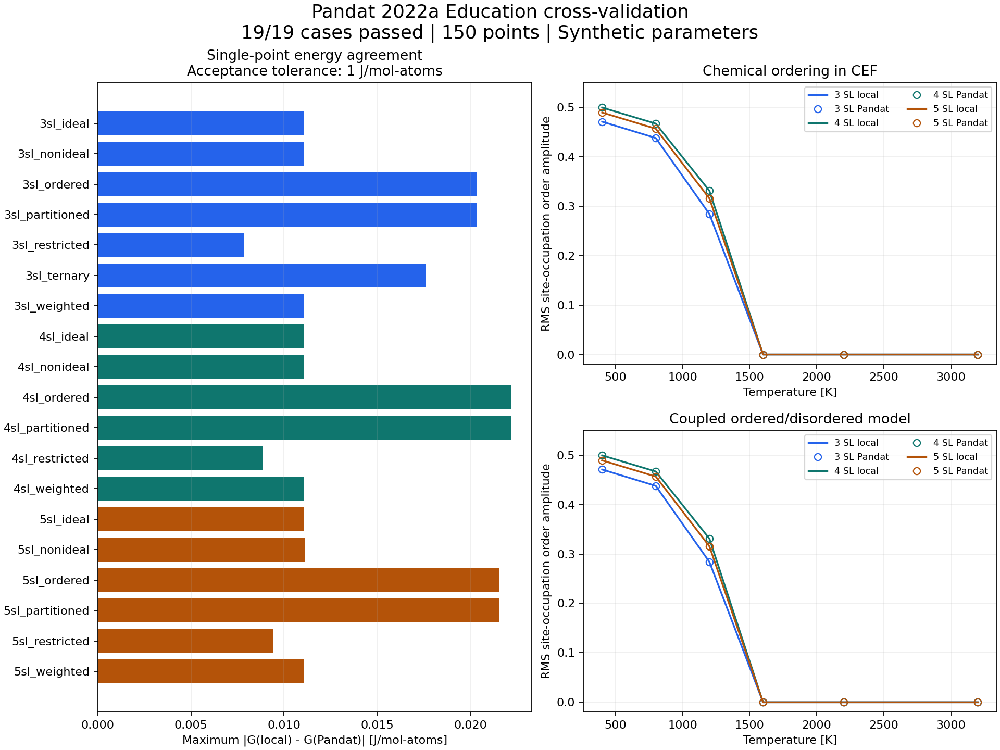

# 三、四、五亚点阵与化学有序化验证

2026-10-18，在本地 **Pandat 2022a Education（文件版本 2022.0.0.0）** 与本程序的 pycalphad 0.11.1 模型之间完成了 **19 组、150 个独立单点**的交叉验证。全部通过预设的 1 J/mol-atoms 绝对容差，最大自由能差 **0.02218515 J/mol-atoms**。本次使用人工构造的参数验证计算实现，没有评估真实材料数据库的预测准确度，也未运行 Thermo-Calc。

## 验证矩阵

| 模型 | 亚点阵数 | 每组点数 | 验证内容 |
|---|---|---:|---|
| 理想 CEF | 3 / 4 / 5 | 10 | 相同占位、构型熵、纯组元端点 |
| 不等位点权重 | 3 / 4 / 5 | 10 | 位点数 1:2:…:n，原子摩尔归一化 |
| 非理想 CEF | 3 / 4 / 5 | 10 | 不等权重、非对称端元、各亚点阵二元相互作用 |
| 受限组元 | 3 / 4 / 5 | 6 | 最后一亚点阵仅允许 NI，可行成分边界 |
| 独立 CEF 化学有序化 | 3 / 4 / 5 | 6 | 低温不同占位、高温随机占位、内部自由能最小化 |
| 有序/无序相耦合 | 3 / 4 / 5 | 6 | 原生 DISORDER_PART 模型、无序参考项、有序修正 |
| 三元截面 | 3 | 6 | AL–NI–MO，固定 X(MO)=0.5，组元守恒 |

| 亚点阵数 | 组数 | 点数 | 最大绝对自由能差，J/mol-atoms |
|---|---:|---:|---:|
| 3 | 7 | 54 | 0.02035379 |
| 4 | 6 | 48 | 0.02218515 |
| 5 | 6 | 48 | 0.02153288 |

压力均为 101325 Pa。理想、不等权重、非理想模型在 600/1600 K 计算五个成分点；受限与三元模型在 700/1700 K 计算三个成分点。有序模型在 400、800、1200、1600、2200、3200 K 计算固定成分的 G–T 曲线，NI 原子分数分别为 2/3、1/2、3/5。每点使用 24 或 32 个优化起点，完整条件由生成的 `request.json` 保存。



逐组误差见 [汇总 CSV](validation/pandat-2022a-summary.csv)。曲线连线用于连接采样点，没有由此认定精确转变温度。

## 有序化如何验证

除 G 值外，还导出 Pandat 的全部亚点阵占位，核对每个亚点阵归一化及加权总成分。把 Pandat 的占位代入本程序表达式，另行检查**同一构型的自由能**，最大差同样小于 0.0222 J/mol-atoms，以区分模型表达式问题与优化结果问题。

各等价亚点阵可能在两个求解器中发生置换，因此不以逐列占位完全相同作为有序化判据。这里使用对等权亚点阵置换不变的量：

\[
q=\sqrt{\sum_s\frac{a_s}{\sum_r a_r}(y_{\mathrm{NI}}^{(s)}-x_{\mathrm{NI}})^2}.
\]

六组有序测试的 q 最大差为 **1.116954×10⁻⁶**，低于预设 1e-3 阈值；400 K 时两端 q 均大于 0.1，3200 K 时均小于 1e-4。本程序优化后的 G 不高于相同总成分的随机占位 G（允许 1e-5 J/mol-atoms 的数值偏差）。这些人工有序模型的位点权重相等；q 是本验证的占位离散程度指标，不用于区分真实晶体的 B2、D0₃、L1₂ 等不同有序结构。

单元测试另行核对理想混合解析解、任意占位的耦合模型解析式、`G_ordered(y=x)=G_disordered(x)`、五亚点阵固定构型、不等权重、限制组元后的随机态扣除，以及缺失端元/函数的拒绝行为。

## Pandat 2022a 兼容处理

- 原生耦合关键字是 `DISORDER_PART`，本机安装示例 `PanPhaseDiagram/Contour/AlFe.tdb` 中也使用该写法。本程序解析时将其转换成 pycalphad 的 `DISORDERED_PART`，记录转换信息，并保留原文件哈希。两个求解器读取的是同一个 TDB 文件。
- 耦合样例将有序侧位点数设为各 `1/n`、无序侧设为 `1`，相关端元能量按相同化学式单位生成。未归一化的有序侧总位点数与无序侧不一致时，本机 Pandat 没有成功完成计算；本程序不擅自修改用户数据库的位点数或能量。
- 当有序占位消失时，Pandat 报告相名 `DIS`。采用 `y(*@*)` 导出实际分支占位，保留 `reported_phase` 和原始 DAT；仅对已声明的单亚点阵无序参考相，将其占位展开到等价有序亚点阵。无序相输出的 G 直接参与比较，没有重新计算或替代外部能量。一般 CSV 导入器仍拒绝任意相名替换。
- 原始表含单位行；输入压力使用 atm，导入转换成 Pa。首行结果可能只有六位有效数字，匹配占位和成分采用显式 `fraction_atol=2e-6`。不对能量平移、拟合或插值。
- 批处理按顺序执行，以每点成功日志和完整输出为判据，退出码 0 本身不足以确认成功。各次执行保存可执行文件 SHA256、日志和退出方式。

## 复现与证据

安装项目和 `requirements-thermo.txt` 后，在 Windows、自己的 Pandat 安装下运行：

```powershell
python -m examples.pandat_validation --executable 'D:\Program Files\CompuTherm LLC\Pandat 2022a Education\bin\Pandat.exe' --version '2022a Education (2022.0.0.0)'
# 可只运行某些模型
python -m examples.pandat_validation --executable 'D:\Program Files\CompuTherm LLC\Pandat 2022a Education\bin\Pandat.exe' --version '2022a Education (2022.0.0.0)' --cases 3sl_partitioned 4sl_partitioned 5sl_partitioned
# 从一次或多次互不重复的运行生成 CSV、JSON、PNG、SVG 汇总
python -m examples.pandat_report data/pandat_validation_<编号>/summary.json
```

验证脚本全部通过退出 0，有失败或缺失输出退出 5。每次运行写入 `data/pandat_validation_<编号>/`，每组保留 `model.tdb`、`request.json`、`points.pbfx`、`raw/*.dat`、`raw/console.log`、`execution.json`、`reference.csv`、`compare.json` 和 `audits.json`，汇总链接到本程序曲线结果及逐点误差文件。所有数据库均由 `examples/pandat_models.py` 生成，原始 Pandat 输出独立获取。

本次通过的运行目录为 `pandat_validation_42ad0f4e9fd2`（16 组）和 `pandat_validation_3f85f2b1e915`（3 组耦合模型），汇总为 `pandat_validation_report_90fc7823f090`。这些位于本地 `data/`，不加入版本库；文档中的图和汇总 CSV 是对应快照。Pandat 可执行文件 SHA256 为 `0241fbd67057e5fe77cec353b9e17edf9060f0eeba5455b86797e3a70fb213c9`。

## 范围

这 19 组验证覆盖上述中性元素、固定比例的置换亚点阵 CEF 和化学有序模型。空位/间隙模型、有序侧磁性耦合及真实材料示例已在后续 [专项验证](gibbs-material-validation.md) 中检查，其中保留了四亚点阵磁性模型的求解分支反例。带电或分子组元、MQMQA、多相/同相分裂平衡仍不在已验证范围。全部单点通过也不构成多起点局部优化的全局最优证明。
